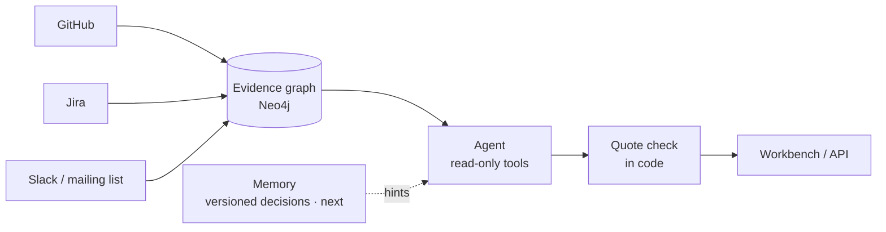
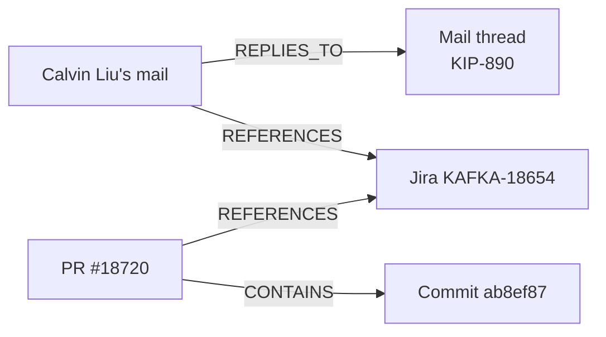
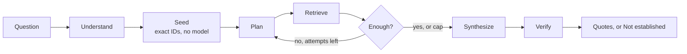

# Engineering Memory

Ask *why is this code like this?*, *what broke here?*, or *is it safe to change?* and get an answer from the team's GitHub, Jira, and chat history. Every claim that survives carries a word-for-word quote from a source the agent actually retrieved. With nothing to cite, the answer is **"Not established"**.

This repo is the prototype (`hackfront` in Python, `sdlc-agent` on GitHub). The hosted demo is [https://sdlc-agent-five.vercel.app](https://sdlc-agent-five.vercel.app). **Try the demo** on the landing page, and **Try the Kafka demo** on the workspaces page, both open `/w/kafka` — the Apache Kafka workspace, which is the demo to use when that workspace is seeded.

- Pitch: [docs/Engineering-Memory-Pitch.pptx](docs/Engineering-Memory-Pitch.pptx)
- Demo video: [docs/engineering-memory.mp4](docs/engineering-memory.mp4)
- Remotion scenes and the rebuild pipeline: [video/](video/)

## The problem

The reason a line of code looks the way it does is scattered across pull requests, commits, tickets, and discussion threads. An engineer can read what the code does and still not know why the team chose it. Engineering Memory puts those records in one evidence graph and lets an agent answer from that graph, with quotes, or refuse.

## What we built

A working prototype, not a memory product with a lasting-facts store. What runs today:

- **Connectors** for GitHub, Jira, and Slack. The Kafka mailing list is stored in the Slack shape as a stand-in for chat. Demo and live data go through the same clients and mappers.
- **An evidence graph in Neo4j.** One node per item. An edge exists only where a source states the link. Nothing is inferred from keywords or timing (`src/hackfront/ingest/extraction/links.py`).
- **A checked agent.** LangGraph runs *understand → seed → plan → retrieve → evaluate → synthesize → verify*. Evaluate can return to plan (at most 3 rounds). The model picks from fixed read-only tools. Plain code keeps or drops each quote (`src/hackfront/agent/flow.py`, `src/hackfront/agent/verify.py`).
- **A workbench.** FastAPI plus the Next.js app in `web/`: workspaces, sync, blame, an ask box, a live trace, and claim-level answers.
- **A benchmark harness** over a public Kafka corpus and 75 gold questions. The questions are in the repo. None are marked human-verified, so this README does not claim an accuracy score. The full comparison against no-retrieval, BM25, and Graphiti is still ahead (`data/EVAL_PLAN.md`).

**Memory** — versioned decisions that point at evidence and are never cited themselves — is the next layer. The landing diagram draws it dashed.

The seeded **Kafka** workspace is the demo the landing describes: real Apache Kafka mail, Jira, GitHub, and KIP pages, with saved investigations. A smaller synthetic workspace (Acme) still exists for a local run with no corpus: `uv run hackfront demo`.

### Figures the landing and the video script stand behind

Early, and one run each. The gold set is not human-checked.

| What | Figure |
|---|---|
| Kafka demo workspace | 1,201 items (1,070 mail, 96 Jira, 25 GitHub, 10 KIP pages) and 2,194 links among loaded items (2,854 including links to items that were not loaded). 10 KIPs, KIP-98 through KIP-890. 4 saved investigations |
| Eval corpus alone | 1,191 artifacts and 1,786 explicit links. `data/MANIFEST.md` says `hackfront eval-load` loads 1,191 artifacts. KIP pages stay out of the eval workspace; they are the answer key. The demo workspace adds those 10 pages |
| Real-model gate | 5 / 7 end-to-end cases. The two misses answered with low confidence. The gate runs on a small made-up company: 4 answerable, 2 that must say "Not established", 1 check that another workspace sees nothing |
| Quote check | Q050 kept 26 / 27 quotes. Q030 kept 5 / 5. Q006, which has no answer in the data, came back "Not established" |
| Reachability, no model | Gold sources 6 / 33 → 19 / 33. Fully reachable questions 1 / 18 → 9 / 18 |
| Tests | The landing reports 445 passed, 7 skipped. That figure was not re-run for this README |
| Gold set | 75 questions in `data/gold/questions.jsonl`: A 16, B 24, C 20, T 10, N 5. Split 19 dev / 56 test. `human_verified` is false on all 75 |

The four questions filed for the Kafka demo are in `data/kafka_demo_questions.json` (Q013, Q026, Q030, Q041). Q041 is the investigation the video script walks through: why producers in 3.0 and 3.1 stayed non-idempotent by default.

## Mental model

A librarian who only answers with a quote that is actually on the shelf. The shelves are PRs, commits, tickets, and threads. A string between two items exists only where someone wrote the link down. The model proposes. Code decides.

### How items get linked

From the landing diagrams and [docs/architecture.md](docs/architecture.md):



Edges, and only these:

- `REPLIES_TO` — a reply belongs to its thread.
- `CONTAINS` — a pull request contains a commit.
- `REFERENCES` — one item mentions another, either because the source says so (a comment sits on its PR or ticket) or because the text contains an identifier: a Jira key, a PR or commit URL, `#N` inside a GitHub record, a Slack permalink, or a `KIP-N` when that page is in the workspace.

Each edge stores `origin` (`structural` or `text`) and a locator such as `$.title#0-11`. Tokens like `UTF-8`, `SHA-256`, and a bare `#333` do not become links.

A chain the landing draws from the Kafka data (KIP-890). Arrows follow the edge direction in that diagram: the reply points at its thread, a mention points at the thing mentioned, and the PR points at the commit it contains.



### How an ask walks the graph



Seed pulls ticket keys, PR numbers, and file paths out of the question with no model. Plan may request up to 5 tool calls. The tools are `find_text`, `file_history`, `neighbors` (one hop), `evidence_chain` (up to three hops), and `get`, plus a guarded `cypher_query` that may only find IDs. The model cannot open an ID it has not already seen. Templates are EXPLAIN-checked, writes are blocked, and queries are time-limited.

Verify keeps a citation only when its ID is in the retrieved evidence and, if it has a quote, that quote is a verbatim span of that item's text. A "supported" claim with no surviving citation is downgraded. Confidence drops when anything was dropped or the evidence was judged thin. No evidence at all returns "Not established" without another model call.

The landing's detail note also describes retrieve as following one hop after the searches. On this branch that hop is a tool call (`neighbors` or `evidence_chain`). `src/hackfront/agent/flow.py` does not add a separate expand step after retrieve.

## Where things live

```
src/hackfront/ingest    GitHub, Jira, Slack, link extraction, Neo4j, sync, synthetic demo
src/hackfront/agent     LangGraph flow, read-only harness, verifier, model client
src/hackfront/api       FastAPI, per-workspace routes, SSE investigations
src/hackfront/eval      Kafka corpus loader, benchmark systems, scoring
src/hackfront/migrations  kafka workspace (slug kafka, name Apache Kafka)
web/                    Next.js landing page and workbench
data/gold/questions.jsonl   75 gold questions
data/kafka_demo_questions.json  four Kafka demo questions
data/raw/               Kafka corpus, gitignored; see data/MANIFEST.md
docs/architecture.md    platform, evidence chain, agent loop, graph contract
docs/workbench-api.md   UI ↔ API contract
docs/deploy.md          UI on Vercel, API on a container host, Neo4j Aura
docs/deploy-vercel.md   API and UI both on Vercel
SPEC.md                 product scope
```

There is no `docs/adr/` tree in this repo. Architecture decisions that are written down live in [docs/architecture.md](docs/architecture.md) and [SPEC.md](SPEC.md). [docs/Claim Processing Engine.html](docs/Claim%20Processing%20Engine.html) is a proposed claim engine. The page says it is not implemented.

Video pipeline: story in [video/script.md](video/script.md), Remotion scenes in [video/remotion/](video/remotion/) (S1–S3 and S5–S9; S4 is a Playwright recording), stitch steps in [video/README.md](video/README.md). The rendered file checked in for review is [docs/engineering-memory.mp4](docs/engineering-memory.mp4).

Eval notes: [data/EVAL_PLAN.md](data/EVAL_PLAN.md), [data/MANIFEST.md](data/MANIFEST.md), [data/GUIDE.md](data/GUIDE.md). The runner scores only questions with `human_verified=true` unless you pass `--include-unverified` on a dev smoke run.

## Live demo

[https://sdlc-agent-five.vercel.app](https://sdlc-agent-five.vercel.app)

Open **Try the demo** (or **Try the Kafka demo**). Both go to `/w/kafka`, the Apache Kafka workspace. That workspace is the one to show once it has been seeded (`hackfront migrate-kafka`, or the bundle import in [docs/deploy-vercel.md](docs/deploy-vercel.md)). The app has no login. See the sharing note in [docs/deploy.md](docs/deploy.md) before you hand the URL out.

## Run it locally

High level. Names of settings are in [.env.example](.env.example). Do not commit `.env`. Put Neo4j connection settings there. GitHub, Jira, Slack, and model keys are entered per workspace in the UI. The same file lists optional environment fallbacks (`LLM_PROVIDER`, `AZURE_FOUNDRY_ENDPOINT`, `AZURE_FOUNDRY_API_KEY`, `SARVAM_API_KEY`, and the source tokens). Hosted state uses `HACKFRONT_STATE=neo4j` plus `HACKFRONT_SECRET_KEY`, as [docs/deploy.md](docs/deploy.md) describes. Leave secrets out of the repo.

```bash
uv sync
cp .env.example .env          # Neo4j URI, user, password, database
docker compose up -d          # Neo4j on bolt://localhost:7688
uv run hackfront serve        # API on http://127.0.0.1:8000
cd web && npm ci && npm run dev   # UI on http://localhost:3000
```

Then open http://localhost:3000. **Try the demo** goes to `/w/kafka`. That workspace exists after the Kafka corpus is loaded:

```bash
uv run --no-project python data/tools/fetch_kip_raw.py   # fills gitignored data/raw
uv run hackfront migrate-kafka
```

`data/MANIFEST.md` has the fetch notes. Shipping an already-built workspace to a deployed API is in [docs/deploy-vercel.md](docs/deploy-vercel.md).

The synthetic workspace, with no corpus and no source credentials:

```bash
uv run hackfront demo
uv run hackfront ask "Why are gateway retries capped at 3?" --workspace demo
```

Other commands: `hackfront sync --workspace <id>`, `hackfront eval-load`, `hackfront eval --include-unverified` (dev smoke only; gold is not human-verified). Tests that need Neo4j use the compose test database: `uv run pytest tests/ingest tests/agent tests/api -q`.

Deploy: both pieces on Vercel ([docs/deploy-vercel.md](docs/deploy-vercel.md)), or the UI on Vercel and the API on a container host ([docs/deploy.md](docs/deploy.md)).

## Limits

- The API has no login and, locally, binds to 127.0.0.1. Use a read-only Neo4j user anywhere the process is shared.
- Sync is a bounded backfill (20 pages per stream, 100 with `--deep`). Deleted source records are not removed. Incremental sync from a saved cursor is not built.
- Unit tests use scripted models. Real-model behavior is `tests/e2e`.

## Team

**Edge Case** — Shreyas, Soha, Ayush, Saidharan.
