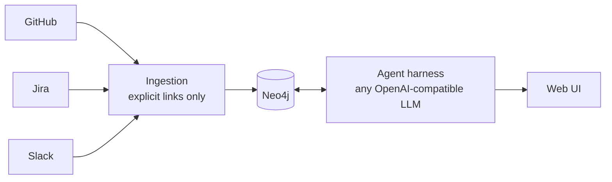

# Engineering Memory

Connect GitHub, Jira and Slack into one **evidence graph**, then ask *why is this code like this?*, *debug this error*, or *is it safe to change this?* and get an answer where every claim links to its source — or an honest "not established".



## What is different

- **Edges are evidence, not guesses.** A link exists only if a source stated it (PR contains commit, reply-to, or an explicit `PAY-412` / PR URL / Slack permalink in text). Each edge records its `origin` and a source locator. No keyword or timing inference.
- **The LLM does not get free rein over the database.** It picks from validated, read-only, capped graph tools; ids must come from evidence already seen; a guarded text2cypher path exists for complex questions and is only used to *find* ids, which are then re-read through trusted templates.
- **Citations are verified in code.** A cited URL that was not retrieved is dropped and confidence is capped. "Not established" is a first-class answer.
- **Demo and live share one path.** Demo data is native-shaped API payloads served to the real clients and mappers.

More: [docs/architecture.md](docs/architecture.md) · scope and acceptance criteria: [SPEC.md](SPEC.md)

## Run it

```bash
uv sync
cp .env.example .env          # Neo4j settings only; everything else is entered in the UI
docker compose up -d          # Neo4j on bolt://localhost:7688 (+ throwaway test DBs on 7689/7690)
uv run hackfront serve        # API on http://127.0.0.1:8000 (no UI of its own)
cd web && npm ci && npm run dev   # the workbench UI on http://localhost:3000 (proxies /api to :8000)
```

If port 3000 is taken, run the UI on another port (`npm run dev -- --port 3100`); any localhost port works. To open the UI from another address (e.g. a LAN IP), start the API with `HACKFRONT_ORIGINS=http://<that-address>:<port>`.

## Onboarding (all in the UI)

Open http://localhost:3000. A **workspace** owns its connections, credentials, AI model and data view.

- **Demo in one click:** *Try the demo workspace* creates "Acme Demo", ingests synthetic GitHub, Jira and Slack data through the real pipeline with live progress, then open a file and **click the `MAX_RETRIES = 3` line**. Each claim is marked supported / inferred / unknown with quotes verified against the sources. Only an AI model key is needed.
- **Your own sources:** *Create workspace*, then on the setup page: enter credentials per source and **Save & test**, pick repos, Jira projects and Slack channels from the discovered lists, add the AI model key, **Start ingestion** and watch it live, then **Open workbench**.

| Source | What to enter |
|---|---|
| GitHub | fine-grained read-only token (Contents, Pull requests, Issues, Metadata) + owner |
| Jira Cloud | site `https://<you>.atlassian.net`, email, API token (id.atlassian.com) |
| Slack | bot token with `channels:history`, `groups:history`, `channels:read`, `users:read`; invite the bot to the channels; your Slack subdomain |
| AI model | Azure Foundry (endpoint + key) or Sarvam (key); optional model name. Any other OpenAI-compatible endpoint is configured through the environment (below). |

Keys are stored per workspace in `.hackfront/workspaces/<id>/secrets.json` on this machine, are write-only (the UI and API show only `••••1234`), and environment variables (`GITHUB_TOKEN`, `SARVAM_API_KEY`, ...) work as a fallback. CLI equivalents: `uv run hackfront demo`, `sync --workspace <id> [--deep]`, `workspaces`, `ask "..." --workspace <id>`.

### LLM provider

The agent talks to models through one small interface (`hackfront.agent.llm.LLMClient`, one `complete()` call) implemented by an OpenAI-SDK client, so any OpenAI-compatible chat-completions endpoint works:

| Variable | Meaning |
|---|---|
| `LLM_PROVIDER` | `openai` (generic), `azure` or `sarvam`; empty = first configured provider |
| `LLM_API_KEY` | key for the generic `openai` provider (environment only) |
| `LLM_MODEL` | model name; required for `openai`, overrides the preset default for `azure` / `sarvam` |
| `LLM_BASE_URL` | generic provider base URL; empty = `https://api.openai.com/v1` (e.g. `https://openrouter.ai/api/v1`, `http://localhost:11434/v1`) |
| `LLM_TIMEOUT` | request timeout in seconds (default 180) |
| `AZURE_FOUNDRY_ENDPOINT`, `AZURE_FOUNDRY_API_KEY` / `SARVAM_API_KEY` | legacy presets, unchanged |

```bash
LLM_PROVIDER=openai LLM_API_KEY=sk-... LLM_MODEL=gpt-4o-mini uv run hackfront ask "Why are gateway retries capped at 3?" --workspace demo
```

An unconfigured provider fails with a message naming the missing variable. Migration: existing Azure/Sarvam settings keep working; to use Azure through the generic path instead, set `LLM_BASE_URL=https://<resource>.openai.azure.com/openai/v1/`, `LLM_API_KEY` and `LLM_MODEL=<deployment>`.

Demo questions: *Why are gateway retries capped at 3?* · *Why is the session TTL 15 minutes?*; and one it cannot answer (*Why did we choose Redis for the session cache?*), where the agent should say "not established".

## Deploy

Free hosting, two options, everything stateful in Neo4j Aura: **all on Vercel** (UI + API as a Python Function; sync runs inside the request with a 240 s budget): [docs/deploy-vercel.md](docs/deploy-vercel.md); or UI on Vercel with the API in a disk-less container (Render free plan blueprint included, no time cap): [docs/deploy.md](docs/deploy.md). Workspaces, saved keys (encrypted with `HACKFRONT_SECRET_KEY`), investigations and sync status live in Neo4j when `HACKFRONT_STATE=neo4j` (local default stays files); `uv run hackfront migrate-state` copies existing local workspaces across.

## Test

```bash
uv run pytest tests/ingest tests/agent tests/api -q   # needs `docker compose up -d` (test Neo4j on 7689)
uv run pytest tests/e2e -v -rs                         # real LLM calls with every configured provider (HACKFRONT_E2E_PROVIDERS=openai,azure,sarvam pins the list); skips with the missing setting
```

Neo4j tests wipe `Artifact` nodes in the **test** database only.

## Layout

`src/hackfront/ingest` contracts, sources (github/jira/slack), extraction (deterministic + text links), Neo4j storage, sync, demo data · `src/hackfront/agent` providers, harness, flow, verification · `src/hackfront/api` FastAPI · `web/` Next.js workbench UI · `research/` background papers.

## Known limits

- Local single-user tool: the API has no login, credentials sit in a local file (not encrypted), and it binds to 127.0.0.1; do not expose it. Run the agent with a read-only Neo4j user in any shared setup.
- Sync is a bounded full backfill (20 pages per stream, 100 with Deep history) through idempotent writes, not an incremental cursor; the UI flags incomplete streams. Text-derived edges are rebuilt from current text on every write; deleted source records are not removed from the graph.
- Real-LLM behaviour is covered by `tests/e2e` and needs a configured provider; unit tests use scripted models.
