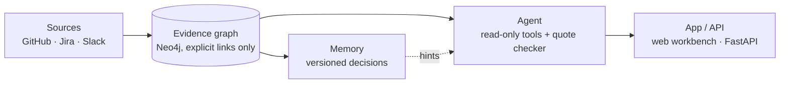

# Engineering Memory

Ask *why is this code like this?*, *what broke here?* or *is it safe to change?* and get an answer built from your team's GitHub, Jira and Slack history.
Every claim comes with a word-for-word quote from its source, or the answer is an honest **"Not established"**.

Prototype. Live demo: https://sdlc-agent-five.vercel.app

## Mental model

A **librarian who only answers with exact quotes**. The shelves are your PRs, commits, tickets and threads. Strings between books exist only where someone wrote the link down. If no quote proves the point, the librarian says "Not established". The AI model proposes; plain code decides.



## How it works

1. **Link.** Each PR, commit, ticket, comment and message becomes one node. Edges come only from what a source states:
   - `REPLIES_TO`: a reply belongs to its thread.
   - `CONTAINS`: a PR contains a commit.
   - `REFERENCES`: one item mentions another, either structurally (a comment belongs to its PR or ticket) or through an identifier in the text: a Jira key such as `PAY-412`, a PR or commit URL, `#123` inside GitHub, or a Slack permalink.

   Each edge records its `origin` and an exact `locator`. Nothing is inferred from keywords or timing (`src/hackfront/ingest/extraction/links.py`).
2. **Remember** *(planned)*. Repeated evidence becomes versioned decisions with a history. Memory will point the agent to evidence and is never cited itself.
3. **Answer.** A LangGraph agent runs *understand → seed → plan → retrieve → evaluate → synthesize → verify* (evaluate can loop back to plan). It calls fixed, read-only graph tools (`find_text`, `file_history`, `neighbors`, `evidence_chain`, `get`, plus a guarded `cypher_query` escape hatch), it may only open IDs it has already seen, and every query is EXPLAIN-checked, write-blocked and time-limited.
4. **Verify** (`src/hackfront/agent/verify.py`). Code keeps a citation only if its ID is in the retrieved evidence and its quote is word for word in that item's text. Made-up IDs and misquotes are dropped, URLs that are not evidence are removed, a "supported" claim with no surviving citation is downgraded to "inferred", and confidence drops to low when anything was dropped or the evidence was judged insufficient. With no evidence at all, the answer is "Not established".

   *Not in main yet:* the unmerged `m1-retrieval` branch adds a one-hop expand step after retrieve, stricter quote checks (own text only, author match) and an explicit established / "Not established" decision. The landing page describes the prototype including that work.

More: [docs/architecture.md](docs/architecture.md) · claim rules: [docs/workbench-api.md](docs/workbench-api.md) · scope: [SPEC.md](SPEC.md)

## Results (early)

One run each, on a gold set that hasn't been human-verified yet; no accuracy benchmark yet. Except for the main test suite, these were measured on unmerged branches (commit shown), not on main.

| What | Result |
|---|---|
| Test suite on main (`dd6aac1`, with Neo4j) | 260 passed, 12 skipped |
| Real corpus (`d567eec`, PR #2) | 1,191 Apache Kafka items, 1,786 explicit links, 10 KIPs |
| Real-model gate (7 end-to-end cases on the demo data, `916922e`) | 5 / 7 pass |
| Kafka questions (`916922e`) | Q030: 5/5 quotes kept · Q050: 26/27 kept · Q006 (no answer in the data): correctly "Not established" |
| Evidence reachability, no LLM (raw question, before → after `916922e`) | gold sources 6/33 → 19/33 · questions 1/18 → 9/18 |
| Test suite on `m1-retrieval` (`9574dae`) | 445 passed, 7 skipped |
| 75-question benchmark (tiers A/B/C/T/N) | next |

## Quickstart

```bash
uv sync
cp .env.example .env              # Neo4j settings only; other keys are entered in the UI
docker compose up -d              # Neo4j on bolt://localhost:7688 (+ test DBs on 7689/7690)
uv run hackfront serve            # API on http://127.0.0.1:8000
cd web && npm ci && npm run dev   # UI on http://localhost:3000 (proxies /api to :8000)
```

Open http://localhost:3000/workspaces and click **Try the demo workspace**. This ingests a small synthetic GitHub, Jira and Slack company through the real pipeline. Only an AI model key is needed. Then ask *Why are gateway retries capped at 3?*, or *Why did we choose Redis for the session cache?* (the right answer is "Not established").

CLI:

```bash
uv run hackfront demo                                   # create + sync the demo workspace
uv run hackfront eval-load                              # load the Kafka benchmark corpus from data/raw
uv run hackfront sync --workspace <id> [--deep]
uv run hackfront ask "Why are gateway retries capped at 3?" --workspace demo
uv run hackfront eval --include-unverified             # dev smoke run of b0,b1,s-,s (gold not yet human-verified)
```

**AI model.** Azure Foundry or Sarvam (`hackfront.agent.llm`). Enter the key per workspace in the UI, or set the fallback in `.env`: `LLM_PROVIDER=azure|sarvam`, `LLM_MODEL`, `AZURE_FOUNDRY_ENDPOINT` + `AZURE_FOUNDRY_API_KEY`, or `SARVAM_API_KEY`.

**Tests.**

```bash
uv run pytest tests/ingest tests/agent tests/api -q   # needs `docker compose up -d` (test Neo4j on 7689)
uv run pytest tests/e2e -q                            # real-LLM gate; skips providers without keys
```

**Deploy.** All on Vercel ([docs/deploy-vercel.md](docs/deploy-vercel.md)), or UI on Vercel with the API on Render ([docs/deploy.md](docs/deploy.md)). Hosted state lives in Neo4j Aura (`HACKFRONT_STATE=neo4j`).

## Repo layout

```
src/hackfront/ingest   sources (github, jira, slack), link extraction, Neo4j writer, sync, demo data
src/hackfront/agent    LangGraph flow, read-only harness, verifier, LLM client
src/hackfront/api      FastAPI (SSE investigation stream)
src/hackfront/eval     Kafka corpus loader, benchmark systems, scoring
web/                   Next.js landing page + workbench
data/                  Kafka raw data (data/raw) and 75 gold questions (data/gold)
tests/                 unit, integration (Neo4j) and e2e (real LLM)
docs/                  architecture, API, deploy
```

## Known limits

- Local single-user tool: the API has no login and binds to 127.0.0.1. Use a read-only Neo4j user in any shared setup.
- Sync is a bounded full backfill (20 pages per stream, 100 with `--deep`). Deleted source records are not removed.
- Unit tests use scripted models. Real-model behaviour is covered only by `tests/e2e`.

## Future scope

- Memory engine (versioned decisions, `decides` / `supersedes` links)
- Incremental sync from a saved cursor, then webhooks
- Human-verified gold set, and a full benchmark against no-retrieval, BM25 RAG and an outside system (Graphiti)
- More sources (wikis, CI logs, incidents) and one identity per person across tools
- The same read-only, quote-checked access for other agents over the API
