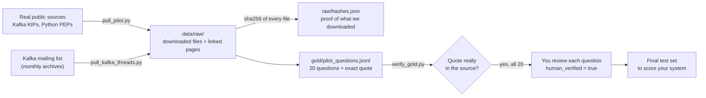
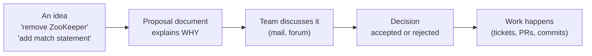
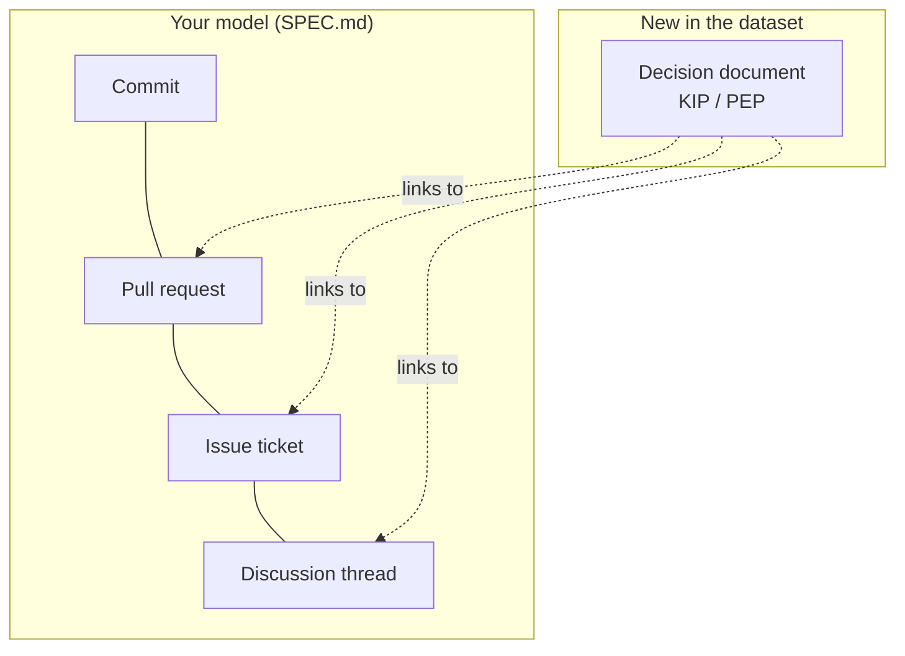
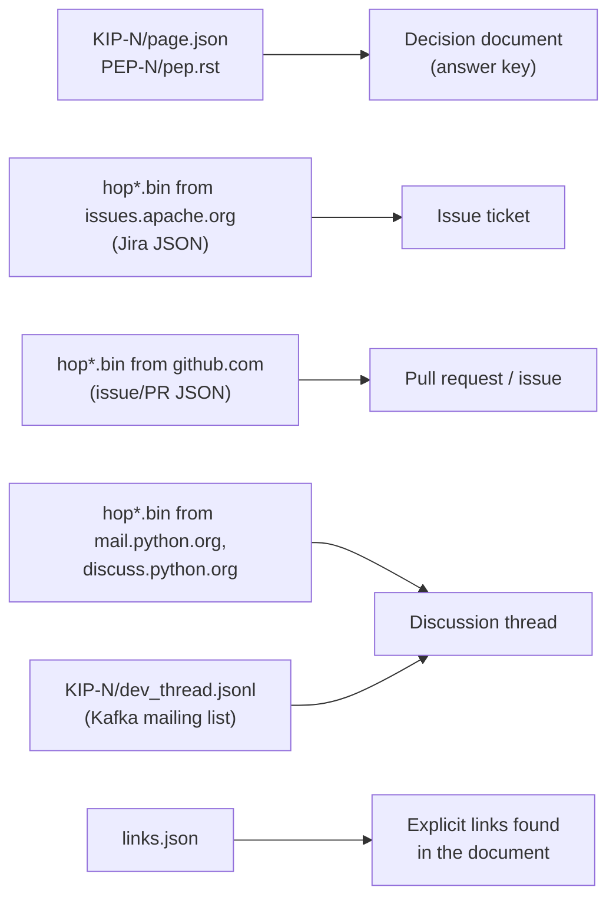
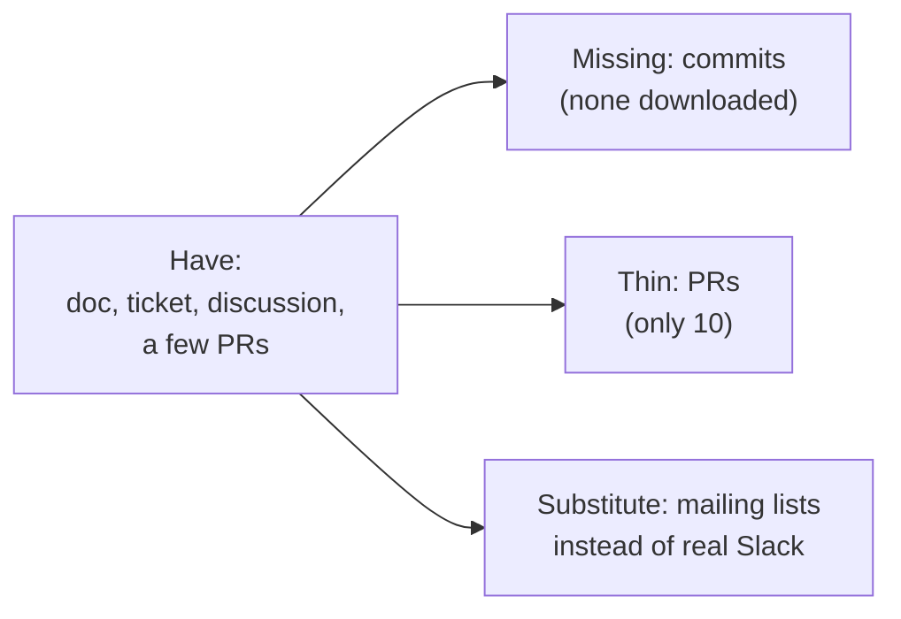
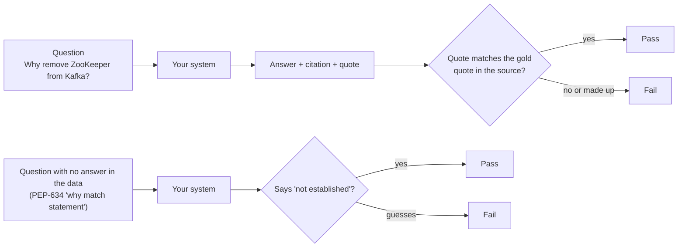

# Data folder in pictures

Beginner guide. Four small ideas, one picture each. (Mermaid diagrams: open in VS Code with a Markdown preview, or on GitHub.)

## 0. The whole flow

## 1. What a KIP and a PEP are

They are the "why" documents. A team writes one before a big change.

| Name | Project | Meaning |
|---|---|---|
| **KIP** | Apache Kafka | Kafka Improvement Proposal |
| **PEP** | Python | Python Enhancement Proposal |

The product answers "why is the code like this?". The KIP or PEP is where the reason is written down on purpose, so it is the **answer key** for testing.

## 2. Your data model next to the dataset

Your four artifact types stay the same. The one addition is the **decision document**: it holds the gold answer and is not a graph node yet.

## 3. Which downloaded file is which of your types

Counts after the Kafka mailing-list rebuild:

| What | How many |
|---|---|
| Decision docs | 20 (10 KIP, 10 PEP) |
| Jira issue tickets | 16 |
| GitHub issues or PRs | 10 |
| Python mail / forum threads | 30 |
| Kafka mailing messages (`dev_thread.jsonl`) | 1,070 across 10 KIPs |
| **Commits** | **0** |

## 4. What is missing

Questions about the decision doc plus a discussion can be tested now. Questions about commits or code lines (like clicking `MAX_RETRIES = 3`) cannot, because no commits were pulled yet. Next step: pull the commits and PRs that the Jira tickets and GitHub links point to.

## 5. How a test will work later

The bottom row is what makes the system different: most tools answer even when they should not.

## File map

| Path | What it is |
|---|---|
| `RESEARCH.md` | What datasets exist online, and the plan to compose one |
| `MANIFEST.md` | Sources, terms, results so far |
| `GUIDE.md` | This file |
| `raw/` | Downloaded originals (gitignored; `raw/hashes.json` is kept) |
| `gold/pilot_questions.jsonl` | 20 draft questions with exact quotes, awaiting your review |
| `tools/` | `pull_pilot.py`, `pull_kafka_threads.py`, `verify_gold.py` |
