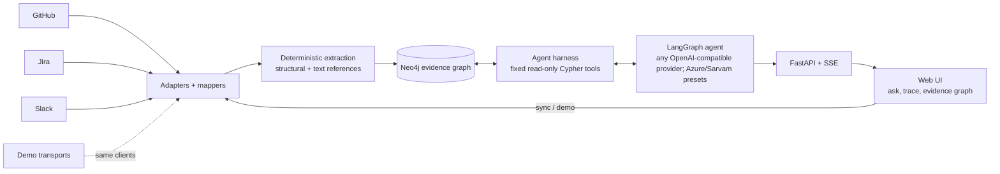
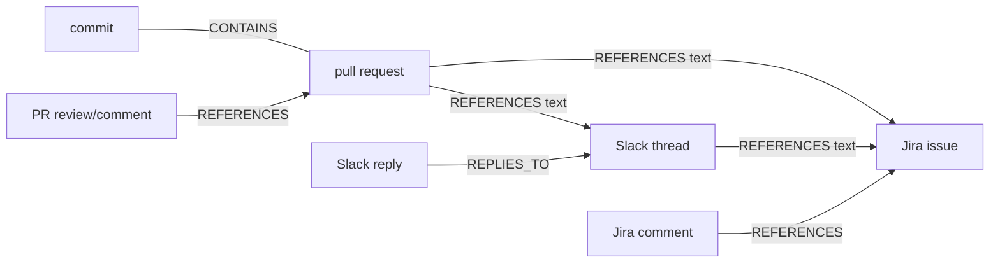
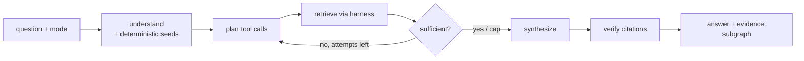

# Architecture

## Platform

## What is different here

1. **Edges are evidence, not guesses.** An edge exists only if a source stated it: structurally (PR contains commit, reply-to) or by an explicit identifier in text (`PAY-412`, a PR URL, a Slack permalink). Every edge has `origin` (`structural` | `text`) and a `locator`. Nothing is inferred from keywords or timing.
2. **The LLM never writes Cypher.** It picks from a small set of validated, read-only, capped tools. Ids must come from evidence already seen, so hallucinated ids cannot reach the database. Every template is EXPLAIN-checked at startup.
3. **Citations are verified in code.** Each cited URL must be in the retrieved evidence, else it is dropped and confidence is capped. "Not established" is a first-class answer.
4. **One path for demo and live.** Demo data is native-shaped API payloads served by fake transports into the real clients and mappers, so the demo exercises production code.

## Evidence chain

(`PR CONTAINS commit`: the edge is written from the PR to the commit. Reference edges point from the artifact that mentions to the artifact mentioned. Traversal is undirected.)

## Agent loop

## Graph contract (shared by ingestion, harness, API)

Nodes `:Artifact` keyed by `canonical_id` (`provider:workspace:record_type:native_id`). Properties: `record_kind` (git_commit | pull_request | issue | discussion_thread | discussion_message), `title`, `text`, `source_uri`, `event_time`, `change_paths`, `is_stub`, `provider`, `context_json`, `actor_display_name`, `actor_handle`. Stubs (`is_stub=true`) are referenced-but-not-ingested targets; never cite them as evidence.

Relationships `REFERENCES | CONTAINS | REPLIES_TO | PARENT_OF | CHANGES` with `canonical_id`, `kind`, `locator`, `origin`, `source_uri`, `observed_at`. Commit-parent edges are `REFERENCES` with locator starting `$.parents`; harness traversal skips them.

## Harness tool row shape

Every tool returns rows: `{id, kind, title, text, url, time, paths, hops?, via?}` (`text` truncated to 600 chars). `via` = `{rel, origin, from}` for traversal results. Tools: `find_text(query)`, `file_history(path)`, `neighbors(id)`, `evidence_chain(id)`, `get(id)`.

## API

`GET /api/status` · `GET/PUT /api/workspace` · `POST /api/sync` · `POST /api/demo` · `POST /api/ask {question, mode, provider}` (SSE: `trace` events then one `answer` event with `evidence: {nodes, edges}`) · static UI at `/`.
