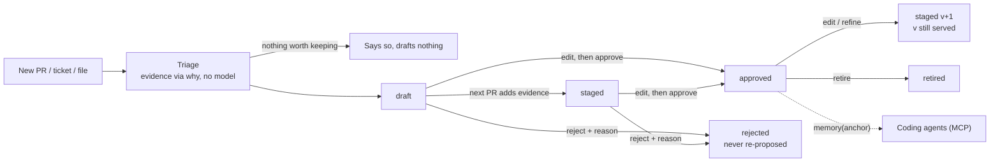

# Memory: reviewed ADRs, rules and episodes

Prototype on `feat/memory-triage-adrs`. Memory is **proposed by code, decided by a person, read by agents**. Nothing is approved automatically.

## Triage in two minutes

Triage is the step that decides **whether a change is worth remembering, and what kind of memory it is**. A person or a PR hook gives it an anchor (a PR, ticket or file). It does four things, in code, with no model:

1. **Gather.** Pull the cited evidence for that anchor from the graph (the same call as `why`).
2. **Classify.** Read each quote and look for three kinds of language:
   - *"decided, instead of, trade-off"* → a **Decision (ADR)**: a choice and its trade-off.
   - *"always, never, must"* → a **Rule**: something agents must follow.
   - *"regression, revert, root cause, outage"* → an **Episode**: what broke, why, and the fix.
3. **Decide.** The kind with the most hits wins and the reason is shown on the entry. No hits means **no draft**; triage says so instead of inventing one. If the evidence matches an open entry, it adds the new evidence to that entry. If you rejected it before, it stays quiet.
4. **Draft.** Fill a template with verbatim sentences. Gaps are marked `TODO` for the reviewer.

Triage never approves. It only fills the review queue; a person approves. Limits: it is keyword-based, so it can misjudge negations or subtle text, which is why the reviewer can re-kind or reject.

## Flow



- **Triage** (`memory.triage`) reads the quotes `why(anchor)` returns and scores them for decision language (ADR), rule language (always / never / must) and incident language (regression, revert, root cause). Highest score wins and the reason is stored on the entry. No signal means no entry. The body is a template filled with verbatim sentences; what the evidence cannot fill is marked `TODO`.
- **Refine**: triaging a new anchor whose evidence overlaps an open entry of the same kind adds only the new evidence and moves it to `staged`. Same evidence again is `unchanged`.
- **Approve** needs at least one evidence item, no `TODO`, and the current version. Approving snapshots the text into `served`.
- **Serving**: agents read `served` only. Editing an approved entry stages a new version; the approved one keeps being served until the new one is approved. Retiring stops serving.
- **Reject** needs a reason and is refused while an approved version is live (retire instead). A rejected entry suppresses re-proposals from the same evidence until reopened.

## Evolving over time

| Event | What the system does |
|---|---|
| A later source says it *replaces* an earlier decision | New entry with `supersedes`; the old one is retired once the new one is approved, and shows *Retired because* and *Replaced by* |
| A later source names an entry's anchor ("keeps the limit from #218") | Evidence is added to that entry; it becomes `staged` and the approved version stays live |
| A cited source is edited | `GET …/memory/drift` lists the entries whose cited text changed; the page shows the old and new text and *I checked it* (`POST …/memory/{id}/acknowledge`) takes the new text as the baseline |
| An agent asks about a file, ticket or PR | `memory(anchor)` resolves it through the graph and returns approved entries that share cited evidence with it |

A worked, staged example with screenshots is in [story.md](story.md).

## Edge cases covered

| Case | Behaviour |
|---|---|
| Same PR triaged twice | `unchanged`, no duplicate |
| Evidence has no signal | `nothing`, nothing stored |
| Two reviewers edit at once | 409 on a stale `version`, checked atomically inside the write (file lock, or one Neo4j query); the UI offers Reload |
| Unsaved edits, then click elsewhere | The UI asks before discarding them, also on tab close |
| Workspace deleted | Its memory is deleted with it, on both state backends |
| Edit an approved entry | Staged copy, live copy untouched, banner says what agents see |
| Reject something already live | Refused; retire it |
| Re-propose after reject | `suppressed` with the earlier reason |
| Approve with unfinished text or no evidence | Disabled, and the reason is printed beside the button |
| Wrong kind guessed | Reviewer re-kinds it in the editor |

## Screens

| Screen | Route | What it is for |
|---|---|---|
| **Overview** | `/w/{ws}/overview` | The home page. Greeting with a one-line summary, the memory waiting for review (click a row to open it), and recent activity (memory changes and questions). |
| **Memory review** | `/w/{ws}/memory` | The four-step strip (Triage, Review, Approve, Agents read) with live counts, a triage box, tabs (Review / Approved / Closed), and the editor. |

**Navigation rule.** The top bar always shows `Workspaces / <workspace> / <page>`, and every part except the current page is a link. The workspace name opens its Overview (the workspace home); `Ask` is a page like the others. The logo goes to all workspaces. The sidebar inside a workspace groups Overview, Ask, Memory, Sync, Ingestion and Settings, and ends with *All workspaces* and *Product overview* (the landing page). Outside a workspace (Settings, Workspaces) there is no sidebar; the top bar offers *Back to <last workspace>* instead.

**Customize.** The Overview has a *Customize* button. Each card (greeting, review queue, activity) can be switched off. The choice is kept in the browser only (`localStorage`), so it never changes what a teammate sees. What the cards show is not configurable: entries cannot be hidden from the queue.

**Buttons, in one place.** Under each entry: *Save edits* (left), then *Reject…* (red outline) and **Approve & publish to agents** (filled). Approve stays off until the text is saved, has no `TODO`, and cites evidence; the reason is printed under the button. Rejecting or retiring asks for a reason first. Approved entries show *Retire…*; closed ones show *Reopen as draft*. A line above the editor says the next step for that status.

## Demo script (5 minutes)

Setup, no Neo4j needed:

```bash
export HACKFRONT_HOME=/tmp/hf-demo
uv run python data/tools/seed_memory_demo.py
uv run hackfront serve                      # API on :8000
cd web && npm run dev                       # UI on :3000, open /w/memo/overview
```

1. **Overview.** "Good morning. 3 entries are waiting for your review." Click *Customize* and hide a card to show it is per person.
2. **Open the Decision.** It is `staged`: a later PR added evidence. The banner says agents still see v3. Nothing live changed.
3. **Open the Episode.** The text has `TODO`; *Approve* is off and says why. Fill the three sections, *Save edits*, then **Approve & publish to agents**.
4. **Show the guard.** Try *Reject…* with no reason (button stays off). Open an approved entry: no *Reject*, only *Retire…*.
5. **Agents.** `uv run python -c "from hackfront import state; from hackfront.mcp_server import recall; print(recall(state.backend().list_memory('memo'), 'outage'))"` returns the approved Episode only. Drafts never appear.

Triage on real data needs the evidence graph (`hackfront migrate-kafka`, Neo4j up), then paste `KAFKA-18654` in the triage box.

## API (per workspace)

`GET /api/w/{ws}/memory?status=` · `POST …/memory/triage {anchor}` · `PUT …/memory/{id} {version, title?, body?, kind?}` · `POST …/memory/{id}/{approve|reject|retire|reopen} {version, reason}`

Entries are stored with the workspace state (`HfMemory` nodes or `memory/*.json`), never as `:Artifact`, so the agent's read-only queries cannot see them.

## Agents

- **MCP**: `hackfront mcp --workspace <ws>` now also exposes `memory(anchor)`: approved entries only, each with its evidence ids. It stays read-only; there is no MCP write path, so an agent cannot approve or even propose.
- **Hook**: CI or a PR webhook calls `POST …/memory/triage` with the PR number. That is the only way a draft appears besides a person pasting an anchor in the dashboard.
- **Drafter seam**: `memory.draft_body(kind, picked)` is a plain function; a model-backed drafter can replace it. The reviewer gate and the verbatim evidence stay the same.

## Not built

- Model-assisted drafting and kind classification; triage is keyword signals and will misjudge subtle text.
- Evidence freshness (an entry citing a deleted or changed source is not flagged).
- Per-user authorship and roles; `by` is the signed-in email or `local`.
- Decision status (live / refined / dead) on `why` results and `check_change(diff)`.
- Browser-checked by hand on seeded data (edit, save, approve, deep links); no automated UI tests yet. Triage against a live graph was not run.
- After an action the confirmation line sits at the top of the page and can be out of view on a long entry.
