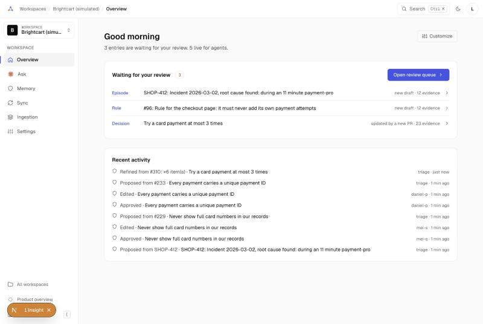
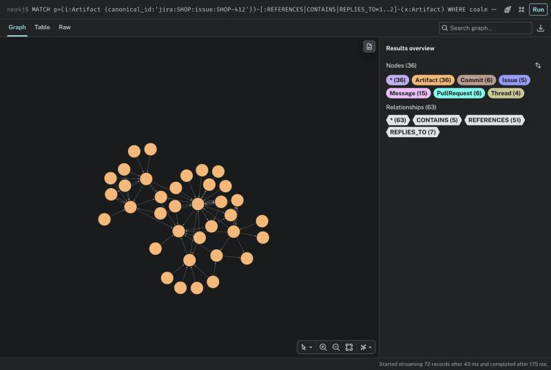
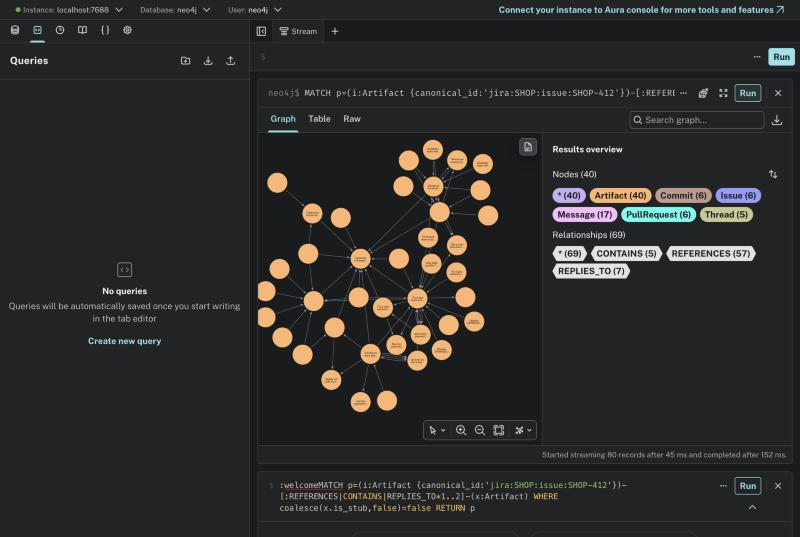
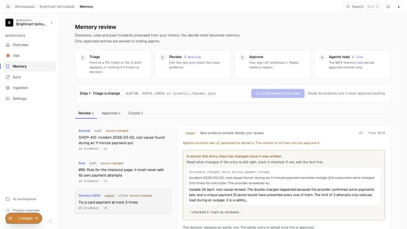
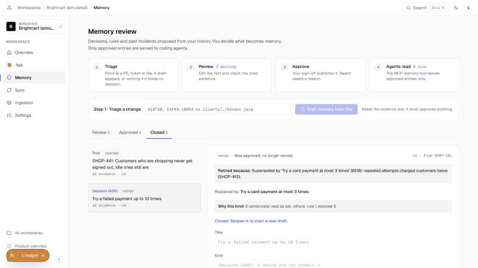
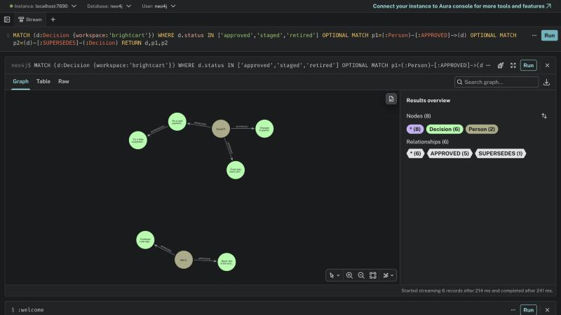
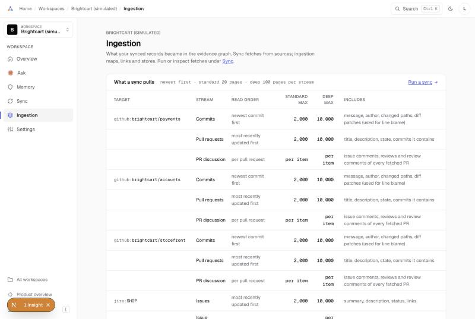
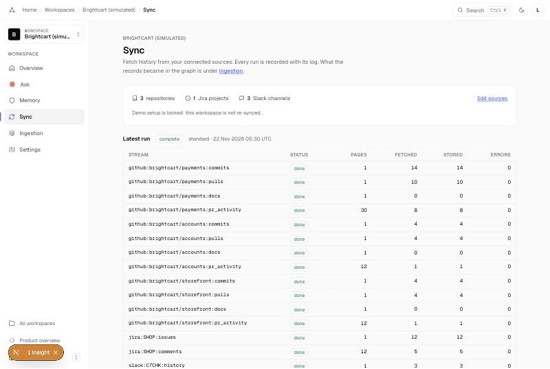
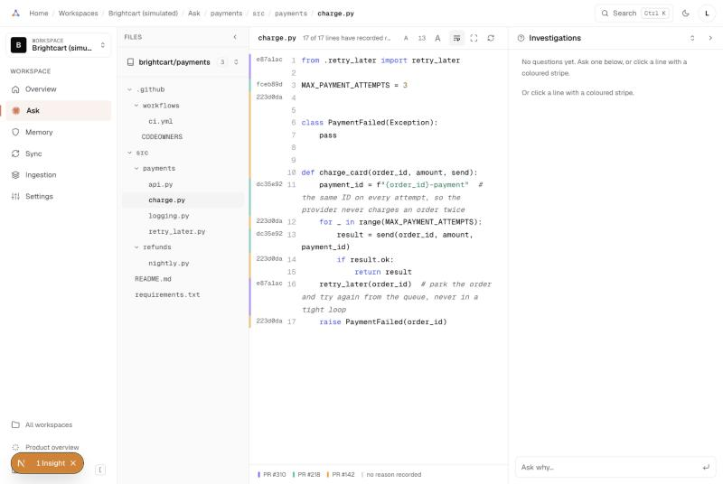
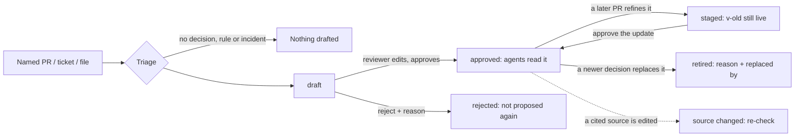

# The Brightcart story

One story that shows the whole product: **an online store that was charged twice, decided never to do it again, and then had a coding agent try to undo that decision.**

Everything in it is **simulated**. Brightcart, its people, customers and numbers are invented. The data is replayed through the same GitHub, Jira and Slack clients the real product uses, so the graph, the answers, the triage and the memory are produced by the real code, not typed in.

## The idea in one paragraph

Teams forget *why*. A line of code says "try a payment at most 3 times", and nothing on the screen says that 214 customers were once charged twice because it used to be 10. A new engineer, or an AI agent, sees a number that looks too low and raises it. This product keeps the reason next to the code: it links the ticket, the discussion, the pull request and the people, turns the important ones into short reviewed notes (decisions, rules, past incidents), and tells an agent about them **before** it edits.

## The cast and the eight things we track

| What you asked about | In Brightcart | Where it lives in the product |
|---|---|---|
| **Users** | Priya (payments), Daniel (eng manager), Mei (security), Leo (support), Sam (reliability), Kai (storefront), and `pr-agent`, an AI agent | Person nodes. Which GitHub, Jira and Slack handles are one person is **declared by the admin**, never guessed |
| **Issue** | SHOP-412 "Customers charged twice", SHOP-377 security audit, SHOP-470 "Failed checkouts up 3%" | Jira issues in the graph |
| **Solution approach** | "Try a payment at most 3 times, and give every payment a unique ID", with the rejected alternative written down | A *decision* (ADR) in the memory |
| **Track** | Ticket status, PR open / merged / closed, a decision going draft → approved → staged → retired | Graph properties plus the memory lifecycle |
| **Discussion** | Slack threads in #checkout-incidents, #security-reviews, #product-and-eng | Thread and message nodes, linked by the permalinks people pasted |
| **Code changes** | Commits and PRs in `payments`, `accounts`, `storefront` | Commit and pull-request nodes with the files they changed |
| **Feedback to code changes** | Sam asks Priya to prove 3 attempts fit in 8 seconds; Daniel approves | Review and comment nodes linked to the PR |
| **Methodology, rules, episodes** | "Never print full card numbers", "Changes to payment attempts need a reliability review", the double-charge incident | *Rules* and *episodes* in the memory |

## The plain-language constraints

Anyone can follow these; they are the whole plot:

- A customer must **never be charged twice** for one order.
- We **try a card payment at most 3 times**.
- Checkout has to **finish within 8 seconds**, or customers leave.
- Customers are **signed out after 15 idle minutes** (a security audit requirement), but **never while they are shopping**.
- **Full card numbers never appear in our records**; only the last 4 digits.
- **Any change to payment attempts or checkout wait time needs a reliability review.**

## Timeline

| When | What happens | Stage |
|---|---|---|
| Nov 2025 | "Try a failed payment up to 10 times so fewer customers see an error" | base |
| Jan 2026 | Security audit: sign customers out after 15 idle minutes | base |
| Feb 2026 | Support asks to undo it; security says no, keeps active customers signed in | base |
| **2 Mar 2026** | **Payment-provider outage: 214 customers charged 2 to 6 times.** Decision: at most 3 attempts + a unique payment ID. The old "10 times" decision is replaced | base |
| Mar 2026 | Follow-ups: payment ID required, card numbers hidden, 8 second limit, reliability review rule | base |
| Apr 2026 | Nightly refunds get the same limit; the checkout page follows | base |
| 14 Apr | Support asks for more attempts: a **new ticket and a new Slack thread** join the incident | stage 1 |
| 20 Apr | A **coding agent opens a PR "raise attempts from 3 to 8"**. It undoes the decision and skips the review | stage 2 |
| 22 Apr | People fix it another way (retry later from a queue), close the agent PR, mark the ticket done | stage 3 |
| 24 Apr | **Two days later the incident ticket is corrected**: the real root cause was a missing payment ID, so the limit of 3 is a safety net, not the fix | stage 4 |

## What to show, in order

### 1. Start from what needs a human


"3 entries are waiting for your review. 5 are live for agents." Recent activity shows the story so far, including *Refined from #310*.

### 2. A new discussion arrives and joins the existing structure
Before (stage 0) and after (stage 1) of the same query around the incident ticket:

| Before | After a new ticket and Slack thread |
|---|---|
|  |  |

36 nodes and 63 links became **40 nodes and 69 links**: one new Issue, one new Thread, two new Messages, attached to the incident by the links people wrote (the ticket key and the Slack permalink). Nothing was re-imported; the graph only grew.

### 3. The coding agent's PR meets the memory (the catch)
Before the agent edits `src/payments/charge.py`, it asks the memory tool. This is the real output (stage 2):

```
rule | Changes to payment attempts or checkout wait time need a reliability review | shared evidence: 2
adr  | Try a card payment at most 3 times                                         | shared evidence: 4
rule | Every payment carries a unique payment ID                                  | shared evidence: 4
```

How it works: the file's history in the graph is looked up, and any **approved** entry that cites any of those records is returned, with how much evidence they share. Drafts and rejected entries never appear. The agent is told what it is about to undo and which review it must ask for.

### 4. People resolve it, and the decision is refined, not rewritten
PR #310 ("retry failed payments later from a queue") says it *keeps the limit of 3 from #218*. Triage reads that and **adds the new evidence to the live decision** instead of creating a duplicate. The decision becomes **staged**: agents still see the approved version until a person approves the update.



### 5. A ticket is edited two days later: the belief shifts
The same screen shows the last step. SHOP-412 was edited on 24 April. Every entry that cites it is flagged **source changed**, with the old text struck through next to the new text. The reviewer reads it and either edits the entry or clicks *I checked it* to accept the new baseline. Nothing is silently rewritten, and nothing silently stays stale.

### 6. A dead decision stays visible, with its reason


"Try a failed payment up to 10 times" was approved in November. It is now **retired because** a newer decision superseded it, and it points to its replacement. The reason is stored, not remembered.

### 7. Who decided what


People (tan) and decisions (green) in the graph database: Daniel approved three, Mei approved two, and one decision supersedes another.

## Easy start, sync, and asking why

**Start in one click.** A new workspace can start from a ready-made demo, or connect GitHub, Jira and team chat with a token and a *Test connection* button. Nothing needs to be installed.

**See what a sync will pull before you run it.** The ingestion page lists every source, the order it reads in (newest first), and the page limits (20 pages standard, 100 deep).



**Watch the sync run.** The sync page shows each source with its status, pages read, records fetched, records stored and errors. Every run keeps its log.



**Ask why from the code.** Open a file. Every line shows who last changed it, and a coloured stripe links it to the pull request that explains it. "17 of 17 lines have recorded reason" means nothing in this file is unexplained. Click a line to ask why; the answer needs a model key and cites exact quotes, or says *Not established*.



## When an ADR is created, and what it suggests

An entry is **never** created by a model on its own and never goes live without a person.

| Trigger | What triage does | Result |
|---|---|---|
| A PR, ticket or file is named (by a webhook, a CI step, or someone typing it in the Memory page) | Reads the record and what it links to. Looks for decision language ("we decided", "instead of", "because"), rule language ("must", "never", "always") and incident language ("root cause", "outage", "hotfix") | One draft: a **Decision**, a **Rule** or an **Episode**. Or **nothing**, and it says so |
| The new source says it *replaces* an earlier decision | Starts a **new** entry that points back to the old one | The old one can be retired once the new one is approved |
| The new source names an existing entry ("keeps the limit from #218") | Adds the new evidence to that entry | The entry becomes **staged**; the approved version stays live |
| A source an entry cites is edited | Compares the cited text with the graph | **Source changed** banner on every affected entry |

What it suggests: a short template filled with **verbatim sentences from the evidence**. Anything it could not fill in is marked `TODO`, and Approve stays off until a person resolves it. A reviewer can change the kind (triage read the 15 minute sign-out as a *Rule*; Mei changed it to a *Decision*).



## Graph database: Neo4j Bloom or Neo4j Browser

The graph holds these labels, so a tool can colour and filter by them:

- Records: `Issue`, `PullRequest`, `Commit`, `Thread`, `Message` (all also carry `Artifact`)
- People and memory: `Person`, `Decision`
- Edges: `REFERENCES`, `CONTAINS`, `REPLIES_TO` (stated by a source), `AUTHORED` (the source names the author; which person is declared), `APPROVED`, `CITES`, `SUPERSEDES`

`hackfront story` writes `Person`, `Decision` and the kind labels. They are a one-way copy for viewing: the agent's read-only queries only ever look at `Artifact`, and a decision is never cited as evidence.

**Why every record looks the same colour in Neo4j Browser.** Every record has two labels: `Artifact` (all records) and its kind (`Issue`, `PullRequest`, `Commit`, `Thread`, `Message`). Neo4j Browser paints a node by its first label, which is always `Artifact`, so records look the same orange. People and decisions do not carry `Artifact`, so they show in their own colours (see screenshot 7). The nodes are different; only Browser's painting hides it.

**Fix it in Bloom:** open the perspective, find the `Artifact` category and **hide it**. Each record then shows under its own kind. Give each kind a colour and show `title` (records) and `name` (people, decisions) as the caption. Suggested colours: Issue purple, PullRequest teal, Commit brown, Thread yellow, Message pink, Decision green, Person tan. Then add these as search phrases. Every query below was run against the live story and returns rows.

| Search phrase | Cypher | What the judges see |
|---|---|---|
| `why $decision` | `MATCH p=(d:Decision)-[:CITES]->(a:Artifact) WHERE d.title CONTAINS $decision RETURN p` | A decision and the tickets, threads and PRs it stands on |
| `who decided` | `MATCH p=(:Person)-[:APPROVED]->(:Decision) RETURN p` | Which person signed off which decision |
| `dead decisions` | `MATCH p=(n:Decision)-[:SUPERSEDES]->(o:Decision) RETURN p` | A decision and the one it replaced |
| `the incident` | `MATCH p=(i:Issue {title:'Customers charged twice during payment outage'})-[:REFERENCES\|CONTAINS\|REPLIES_TO*1..2]-(x:Artifact) RETURN p` | The whole incident cluster: ticket, threads, PRs, commits, reviews |
| `touched $path` | `MATCH (a:Artifact) WHERE any(p IN a.change_paths WHERE p CONTAINS $path) RETURN a` | Every PR and commit that changed a file |
| `agent pr` | `MATCH (pr:PullRequest) WHERE pr.canonical_id ENDS WITH ':pull_request:301' MATCH (d:Decision {workspace:'brightcart'})-[:CITES]->(x:Artifact) WHERE any(p IN pr.change_paths WHERE p IN coalesce(x.change_paths,[])) RETURN pr, d, x` | The agent's PR linked to every decision that guards the file it touches |
| `what did Priya do` | `MATCH p=(:Person {name:'Priya K.'})-[:AUTHORED]->(a:Artifact) RETURN p LIMIT 60` | One person's tickets, PRs, commits and Slack messages across all three tools |
| `unanswered` | `MATCH (t:Thread) WHERE NOT (t)--(:Issue) AND NOT (t)--(:PullRequest) AND NOT (t)<-[:CITES]-(:Decision) RETURN t` | Threads nobody linked to anything, including "why is the maximum order $2,000?": the product says **Not established** instead of guessing |
| `hubs` (table) | `MATCH (a:Artifact)-[r]-() WHERE a.scope IN ['SHOP','brightcart/payments'] RETURN coalesce(a.title,a.canonical_id) AS record, count(r) AS links ORDER BY links DESC LIMIT 5` | The records everything hangs off: the decision PR and the incident ticket |

**In Neo4j Browser** (what the screenshots use): paste a query, press Run, and click a label in *Results overview* to set the caption to `title`.

## Run it

Local, needs Docker for Neo4j:

```bash
docker compose up -d neo4j
export HACKFRONT_HOME=/tmp/hf-demo NEO4J_URI=bolt://localhost:7688 NEO4J_USERNAME=neo4j NEO4J_PASSWORD=hackfront-dev NEO4J_DATABASE=neo4j
uv run hackfront story              # base story + its memory (resets the workspace's memory)
uv run hackfront serve              # API on :8000
cd web && npm run dev               # UI on :3000, open /w/brightcart/overview
```

Then, one stage at a time, while the app is open (each adds data, syncs, and prints what changed):

```bash
uv run hackfront story --stage 1    # new ticket + Slack thread
uv run hackfront story --stage 2    # agent PR; prints what the memory tool tells it
uv run hackfront story --stage 3    # resolving PR; triage refines the live decision
uv run hackfront story --stage 4    # ticket edited; entries that cite it are flagged
```

The stages are one-way on a given database. To replay from the start, use an empty database.

**On the deployed app:** point the same command at the deployed database from your own machine (`NEO4J_*` of the Aura instance, `HACKFRONT_STATE=neo4j`, and the deployed `HACKFRONT_SECRET_KEY`). It creates the `brightcart` workspace as a shared, read-only demo, so judges who sign in can open it but not change it. The credentials stay with you; nothing in this repo needs them.

## What is real and what is simulated

- **Simulated:** every record in the story, and the reviewers' clicks (`story_seed.py` plays Daniel, Mei and Sam so every state exists).
- **Real code:** the GitHub, Jira and Slack clients and mappers, link extraction, the graph, the file history, triage, the lifecycle rules, the drift check, the memory tool and the dashboard.
- **Known limits:** triage is keyword based and can misjudge subtle text (it is why a person approves); the drift check flags every entry that cites a changed source, even when the change does not matter to that entry; the memory tool needs the graph to resolve a file or ticket, and plain-text questions fall back to word matching.
